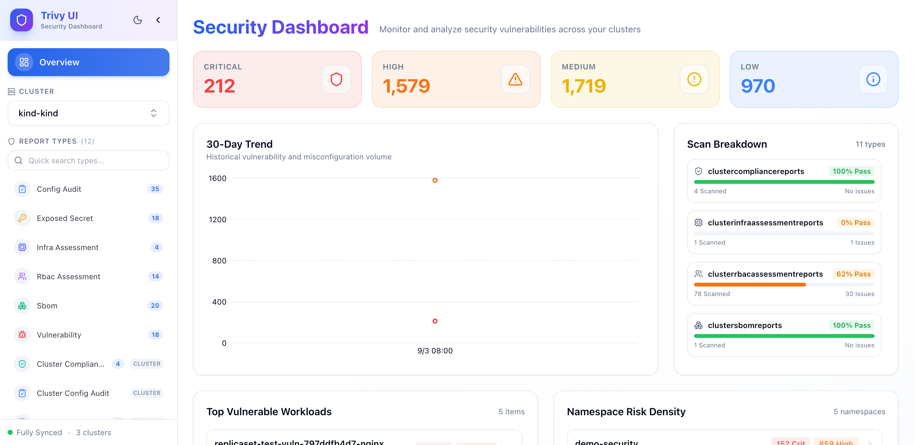
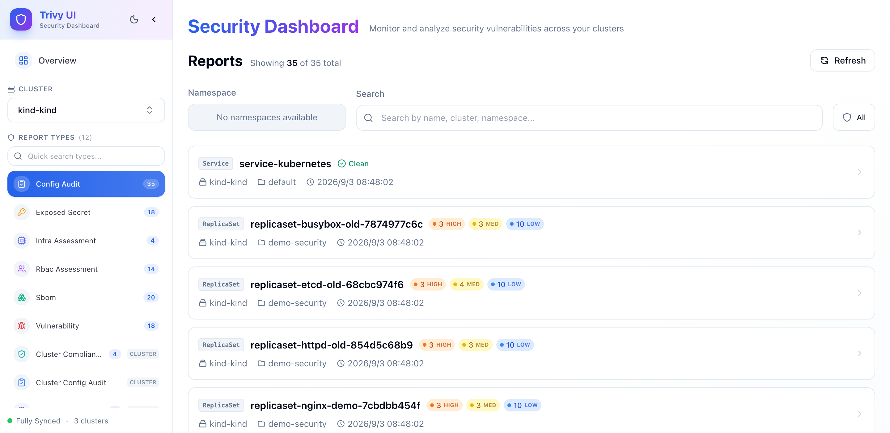
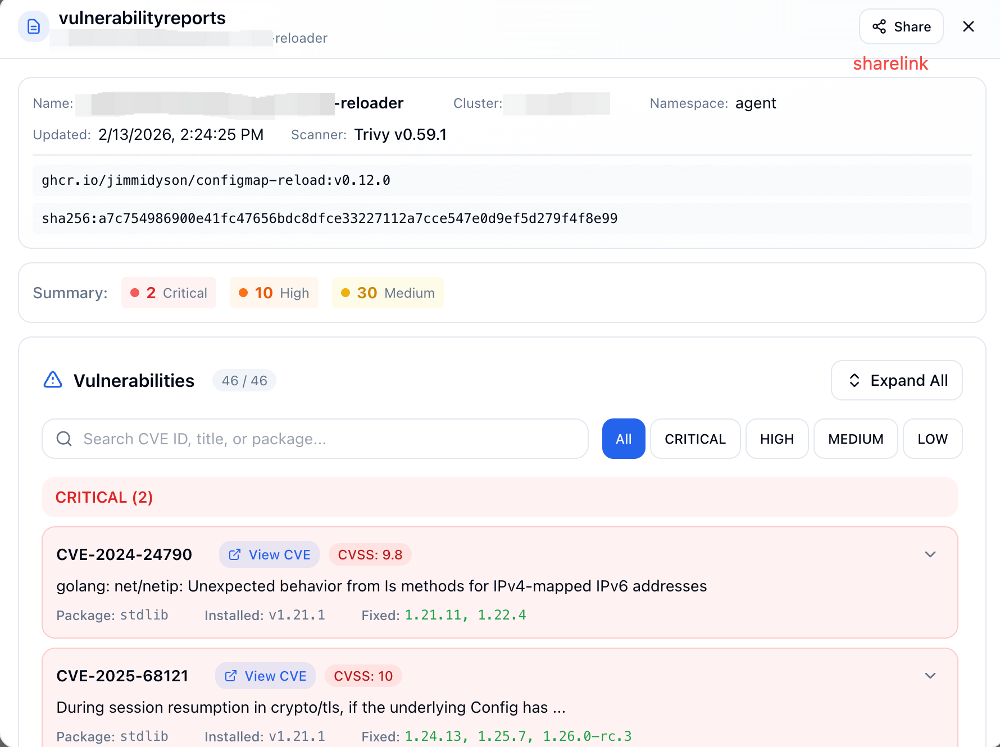

# Dashboard features and navigation

The Trivy UI Dashboard provides a web-based interface for visualizing, filtering, and analyzing security scan results generated by the Trivy Operator across Kubernetes clusters.

## Navigation and sidebar

The left navigation sidebar is designed for fast triage across security domains:

### 1. Resizable sidebar width
- **Drag to resize**: Hover over the right border of the sidebar; the cursor changes to `col-resize`. Click and drag left or right to adjust the sidebar width between **220px and 480px**.
- **Double-click to reset**: Double-click the resize handle at any time to instantly restore the default width (280px).
- **Persistent width**: Your preferred sidebar width is stored in browser `localStorage` (`trivy-ui-sidebar-width`) and maintained across sessions and page reloads.

### 2. Collapsible sidebar
- Click the collapse arrow (`<`) at the top of the sidebar to switch to a compact, icon-only navigation bar.
- In collapsed mode, hover over any icon to view its full title and report count in a tooltip.

### 3. Aqua Security semantic iconography
Every report type is mapped to standard security domain iconography with distinct colors for rapid identification:

| Report Type | Semantic Icon | Theme Color | Focus Area |
|---|---|---|---|
| **Vulnerabilities** | `Bug` | Red | CVEs and software package vulnerabilities |
| **Config Audit** | `ClipboardCheck` | Blue | Kubernetes manifest security misconfigurations |
| **Exposed Secret** | `KeyRound` | Amber | Leaked tokens, private keys, passwords, certificates |
| **Infra Assessment** | `Cpu` | Indigo | Kubernetes node, control plane, and core infra checks |
| **RBAC Assessment** | `Users` | Purple | ServiceAccount and ClusterRole privilege escalation |
| **SBOM** | `Boxes` | Emerald | Software Bill of Materials (SPDX / CycloneDX) |
| **Compliance** | `ShieldCheck` | Teal | CIS Benchmark, NSA, PCI-DSS compliance audits |

### 4. Quick type search
When your cluster has many CRD types (more than 8 types discovered), an inline search input (`Quick search types...`) appears at the top of the report type list. Typing letters instantly filters the navigation list, preventing cutoff on smaller screens.

### 5. Persistent Overview button
Click the **Overview** button (`LayoutDashboard` icon) at the top of the sidebar at any time to return to the cluster summary dashboard.

---

## Cluster Overview dashboard

When a cluster is selected, the main view defaults to the Cluster Overview dashboard:

### Vulnerabilities and other findings
Totals are shown per kind of finding, because adding a critical CVE to a
critical RBAC finding gives a number nobody can act on:
- **Vulnerabilities in container images**: **Critical**, **High**, **Medium**,
  **Low** and **Unknown** (no severity assigned yet), each with how many have a
  fixed version (*fixable*), and how many images are affected.
- **Misconfigurations** (config audit and infra checks), **RBAC** and **Exposed
  secrets**, each with Critical/High counts and how many resources have findings;
  **Compliance** with passed and failed controls. Click a card to open the list.
- Reports of **retired ReplicaSets** (old revisions scaled to zero, kept for
  rollback) are not counted; the overview says how many were left out.

### Trend and scan breakdown
- **Vulnerability trend**: Critical, High and Medium vulnerabilities, plus a
  dashed line for Critical + High findings with a fix. Choose 7, 30 or 90 days.
  Points recorded by versions before this change added up every report type;
  they are hidden once vulnerability-only data exists.
- **Scan breakdown**: per report type, how many resources were scanned and how
  many have findings ("% clean").

### Top vulnerable workloads and namespaces
- **Top Vulnerable Workloads**: vulnerability findings grouped by workload, so a
  Deployment with three containers is one entry named after the Deployment (not
  `replicaset-<name>-<hash>`), with how many are fixable. Click to open its
  report, or the list of its containers' reports.
- **Namespace Risk Density / Leaderboard**: namespaces (or clusters) ranked by
  Critical and High vulnerabilities.

---

## Vulnerabilities and Images views

Two cluster-wide views sit under **Overview** in the sidebar (also linked as
*By CVE* / *By image* on the overview):

- **Vulnerabilities**: every vulnerability once, sorted by severity, then
  whether a fix exists, then how many workloads it affects. Filter by severity,
  *Fixable only*, or search by CVE ID, title, package, workload or image. Expand
  a row for the affected workloads, images and the upgrade (`installed → fixed`),
  plus links to NVD / AVD / GitHub / Go / Debian advisories. Export the current
  result as CSV (one row per affected package and workload) or JSON.
- **Images**: each image once, however many workloads run it, with its
  counts, how many Critical/High findings are fixable, when it was scanned and
  the workloads using it (click to open the report). Export as CSV.

Both follow the namespace filter in the URL (`namespace=`). They are built from
compact findings kept in memory (`CVE_INDEX=false` turns this off for very large
clusters; the views are then empty).

## Reports list and filtering

Selecting any report type from the sidebar opens the paginated reports list:

### Filter bar controls
1. **Namespace selector**: Multi-select dropdown to filter reports by one or more Kubernetes namespaces.
2. **Search bar**: Real-time filtering matching report name, cluster name, namespace, or container image repository.
3. **Sort**: by name, most severe first, most fixable first, or oldest scan first (kept in the URL).
4. **Issue toggle (`All` vs `Issues only`)**:
   - `[ 🛡 All ]`: Shows all scanned reports, including clean components.
   - `[ ⚠️ Issues only ]`: Filters the list to show only reports containing one or more vulnerabilities or audit failures.

### Report cards
Each report card provides concise, actionable metadata:
- **Workload kind badge**: Extracted workload type (`[Service]`, `[ReplicaSet]`, `[Deployment]`, `[DaemonSet]`, `[CronJob]`, `[Pod]`).
- **Workload name**: Reports of a ReplicaSet show the Deployment name, with the report name next to it. Old ReplicaSets kept for rollback are marked **Retired**.
- **Severity indicators**: Compact level pills (`● 3 CRIT`, `● 10 HIGH`, `● 20 MED`, `● 5 LOW`, `● 40 UNK`) and how many Critical/High findings are fixable.
- **Clean indicator**: Reports with zero security findings display a green `[ ✓ Clean ]` badge.
- **Cluster & namespace shortcuts**: Click the cluster or namespace badge to copy its name to the clipboard.
- **Image and scan time**: the scanned image, and when the operator last scanned it; scans older than 3 days are highlighted.
- **Keyboard**: cards can be focused with Tab and opened with Enter.
- **Share report link**: Hover over the card and click the share icon to copy the direct URL.
- **Drill-down cue**: Click anywhere on the card to open the complete report detail drawer.

---

## Report details drawer

Clicking any report opens the comprehensive report detail drawer:

- **Vulnerabilities**: filter by severity or *Fixable*, group *by severity* or
  *by package* (packages with the most severe findings first), export CSV/JSON.
  Large reports render 50 rows per group with *Show more*.
- **Vulnerabilities tab**:
  - CVE ID (with primary link to NVD / vendor advisory).
  - Severity level badge (Critical, High, Medium, Low).
  - Target package name and installed version.
  - Fixed version (when available).
  - CVSS v3 score and vector.
  - Detailed vulnerability description.
- **Configuration audit tab**:
  - Check ID and rule title.
  - Status (`PASS` or `FAIL`).
  - Severity and category.
  - Detailed remediation guidance and suggested manifest fixes.
- **Exposed secrets tab**:
  - Rule ID, category, and severity.
  - File path and line numbers within the container image.
  - Masked snippet preview of the leaked secret.

---

## Live polling and background lifecycle

Trivy UI automatically stays synchronized with your Kubernetes clusters:

- **15-second report refresh**: The reports list automatically checks for newly generated Trivy reports every 15 seconds.
- **15-second counter refresh**: Sidebar badge counts update every 15 seconds.
- **30-second metadata refresh**: Cluster and CRD availability updates every 30 seconds.
- **Background tab sleeping**: When you minimize your browser or switch to another tab (`document.visibilityState === "hidden"`), all automatic polling requests **immediately pause** to conserve workstation battery and network bandwidth. When you switch back to the tab, the dashboard refreshes immediately.

---

## Theme support

Trivy UI features built-in **Dark Mode** and **Light Mode**:
- Toggle themes using the sun/moon icon in the top header.
- Themes adapt all chart colors, badges, and text contrast to ensure optimal readability in any lighting environment.
